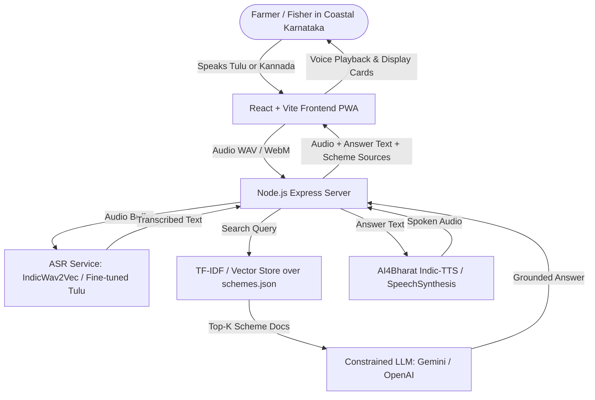

# TuluVaani 🎙️ (ತುಳು ವಾಣಿ)

> **A first-attempt Tulu speech recognition pipeline — demonstrated through a coastal Karnataka scheme & fisheries advisory voice assistant.**
>
> *Tulu (ತುಳು)* is spoken by ~1.8–2.5 million people in coastal Karnataka and Kasaragod, Kerala, yet possesses no production open-source speech recognition (ASR) or synthesis (TTS) infrastructure today.

---

## 1. What This Project Actually Is

This project is **not** merely another wrapper around a government chatbot. The core value and academic contribution lie in **Tulu speech technology**.

| Layer | Component | Purpose & Value |
|---|---|---|
| **Core Research Contribution** | **Tulu ASR Transfer Learning Pipeline** | Fine-tunes `ai4bharat/indicwav2vec-kannada` on a self-collected Tulu speech corpus. Bridges an open NLP/speech gap for a low-resource Dravidian language. |
| **Applied Demonstration** | **Coastal Advisory Voice Assistant** | A voice-first assistant answering queries on coastal Karnataka schemes (PMMSY, Raitha Vidya Nidhi, Krishi Bhagya) and crop/marine advisories. |

---

## 2. Clean Project Structure

```
TuluVaani/
├── client/                     # Frontend Web App (React 18 + Vite)
│   ├── src/
│   │   ├── App.jsx             # Voice UI (mic button, transcription display, audio playback)
│   │   ├── index.css           # Clean mobile-first stylesheet
│   │   └── main.jsx            # React root mount
│   ├── index.html              # App entry HTML
│   ├── package.json            # Client dependencies
│   └── vite.config.js          # Vite config with backend proxy (/api -> http://localhost:5000)
│
├── server/                     # Backend Orchestrator (Node.js + Express)
│   ├── src/
│   │   ├── data/
│   │   │   └── schemes.json    # Knowledge base: coastal Karnataka schemes & crop advisories
│   │   ├── lib/
│   │   │   ├── answer.js       # Grounded LLM answering logic + extractive fallback
│   │   │   └── retrieval.js    # In-memory TF-IDF cosine similarity search engine
│   │   ├── routes/
│   │   │   ├── asr.js          # Speech recognition endpoint (routes to ML service)
│   │   │   ├── query.js        # Question answering & scheme retrieval route
│   │   │   └── tts.js          # Text-to-speech synthesis endpoint
│   │   └── index.js            # Express server entry point (port 5000)
│   ├── .env.example            # Environment configuration template
│   └── package.json            # Server dependencies
│
├── ml/                         # Machine Learning & Speech Pipeline
│   ├── data/
│   │   ├── prompts.json        # Curated Tulu prompts written in Kannada script
│   │   └── sample_manifest.csv # Audio-transcript mapping schema
│   ├── scripts/
│   │   ├── asr_service.py      # FastAPI microservice serving the fine-tuned ASR model
│   │   ├── evaluate_wer.py     # Evaluation script computing Word Error Rate (WER) & CER
│   │   └── prepare_dataset.py  # Audio resampler (16kHz mono WAV) & train/test splitter
│   └── requirements.txt        # Python dependencies (PyTorch, Torchaudio, Transformers, etc.)
│
├── .gitignore                  # Git ignore rules for Node, Python, audio & models
├── LICENSE                     # MIT License
└── README.md                   # Single master project documentation
```

---

## 3. End-to-End System Architecture



---

## 4. Execution Blueprint: How the Whole Project Is Done

### **Phase 1: Working Kannada Baseline & Local Scaffold (Immediate)**
* Run the Express server and Vite frontend locally.
* Test `/api/query` using the built-in TF-IDF retrieval over `schemes.json`.
* The client currently uses the browser's Web Speech API as a working Kannada stand-in so the full loop (mic $\to$ retrieve $\to$ text/audio response) works right away with zero setup.
* Add an LLM API key (`GEMINI_API_KEY` or `OPENAI_API_KEY`) to `server/.env` so `server/src/lib/answer.js` synthesizes natural, grounded answers.

### **Phase 2: Targeted Tulu Speech Data Collection**
* Because no usable open Tulu speech dataset exists, collecting 2–5 hours of targeted audio is part of the core deliverable.
* **Recording Protocol**:
  * Read prompts from `ml/data/prompts.json` (phrases covering fisheries, farming diseases, subsidies, and civic queries).
  * Text is represented in **Kannada script** (the standard written medium for Tulu).
  * Record 6–10 native Tulu speakers (covering Mangaluru, Udupi, and Kasaragod dialect variations).
  * Save as 16,000 Hz (16kHz), single-channel (mono), 16-bit PCM WAV.
  * Map files into `sample_manifest.csv` with speaker ID and transcripts.

### **Phase 3: Fine-Tuning IndicWav2Vec on Tulu (The Research Contribution)**
* **Why Transfer Learning Works**: Tulu heavily code-mixes with Kannada and shares phonetic inventory and script. Starting from `ai4bharat/indicwav2vec-kannada` provides a strong phonetic foundation.
* **Training Workflow**:
  1. Run `python ml/scripts/prepare_dataset.py` to normalize transcripts and create 80/20 train/test splits.
  2. Load `ai4bharat/indicwav2vec-kannada` in PyTorch with Hugging Face `Wav2Vec2ForCTC`.
  3. Fine-tune on Google Colab (Free T4 GPU) using CTC loss.
  4. Run `python ml/scripts/evaluate_wer.py` to evaluate Word Error Rate (WER) and Character Error Rate (CER).
  5. Document failure modes (e.g. nasalized vowels, retroflex consonants, borrowed loanwords).

### **Phase 4: Full App Integration**
* Start the Python ASR microservice (`python ml/scripts/asr_service.py` on port 8000).
* Wire `server/src/routes/asr.js` to forward recorded audio from the React client to the ASR microservice.
* Connect `server/src/routes/tts.js` to AI4Bharat Indic-TTS for Kannada spoken audio generation.

### **Phase 5: Evaluation & Final Deliverables**
* Conduct usability tests with native speakers.
* Compile an honest evaluation report reporting real-world WER, strengths, and failure modes.

---

## 5. Quickstart & Local Setup

### 1. Backend Server
```bash
cd server
npm install
npm run dev
```
* Runs on `http://localhost:5000`.
* Test query endpoint:
  ```bash
  curl -X POST http://localhost:5000/api/query -H "Content-Type: application/json" -d "{\"text\":\"areca nut disease\"}"
  ```

### 2. Frontend Client
```bash
cd client
npm install
npm run dev
```
* Opens on `http://localhost:5173`.
* Tap the large 🎤 button to test voice interaction or type questions into the input box.

### 3. ML / ASR Microservice (Optional for Phase 3/4)
```bash
cd ml
pip install -r requirements.txt
python scripts/asr_service.py
```
* Runs on `http://localhost:8000` with interactive docs at `http://localhost:8000/docs`.

---

## 6. Environment Variables (`server/.env`)

```env
PORT=5000

# Optional: Add for natural LLM responses (Gemini / OpenAI / Hugging Face)
LLM_API_KEY=
HF_API_KEY=

# Optional: Microservice ASR endpoint
ASR_SERVICE_URL=http://localhost:8000/transcribe

# Optional: Database for user query logs
MONGODB_URI=
```

---

## 7. Ethical Scope & Disclaimers

* **Speaker Consent**: All voice contributors must provide informed consent for research and open evaluation use.
* **Groundedness**: The assistant strictly adheres to retrieved government documents. If uncertain, it directs users to their nearest *Raitha Samparka Kendra* or *Fisheries Department* office.
* **Prior Art & Citations**:
  * **AI4Bharat**: IndicWav2Vec2 & Indic-TTS architectures.
  * **Jai Tulunad (Mangaluru)**: Pioneers of FLORES-200 Tulu text groundwork.

---

## 8. License

MIT License. See [LICENSE](LICENSE) for details.
